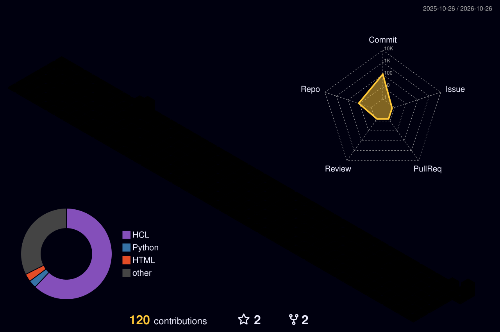

<div align="center">


</div>

<div align="center">

[](https://git.io/typing-svg)

</div>

---

<div align="center">

[](https://linkedin.com/in/pradum-prajapati-790155199)
[](mailto:pradumprajapati482@gmail.com)
[](https://github.com/Pradum9754)
[](tel:+919754020544)

[](#)
[](#)
[](#)
[](#)
[-FF4500?style=for-the-badge)](#)

</div>

---

<div align="center">

## 🏆 IMPACT AT A GLANCE

</div>

<table align="center">
<tr>
<td align="center">

<br/><sub>Hands-on production experience</sub>
</td>
<td align="center">

<br/><sub>via Optimized Azure DevOps Pipelines</sub>
</td>
<td align="center">

<br/><sub>via Blue-Green Deployment Slots</sub>
</td>
<td align="center">

<br/><sub>via AKS + Deployment Slot Strategy</sub>
</td>
</tr>
<tr>
<td align="center">

<br/><sub>via Azure Policy + Key Vault</sub>
</td>
<td align="center">

<br/><sub>via Modular Terraform Architecture</sub>
</td>
<td align="center">

<br/><sub>via DevSecOps Integration</sub>
</td>
<td align="center">

<br/><sub>via Automated Monitoring & Alerts</sub>
</td>
</tr>
</table>

---

## 👨‍💻 PROFESSIONAL SUMMARY

```yaml
━━━━━━━━━━━━━━━━━━━━━━━━━━━━━━━━━━━━━━━━━━━━━━━━━━━━━━━━━━━━━━━━━━━━━━
  PRADUM PRAJAPATI  |  Azure DevOps & Cloud Infrastructure Engineer
━━━━━━━━━━━━━━━━━━━━━━━━━━━━━━━━━━━━━━━━━━━━━━━━━━━━━━━━━━━━━━━━━━━━━━

Experience  : 3.5+ Years | Production Cloud Engineering (US-Based Client)
Location    : Noida, Delhi NCR  |  Remote Ready  |  Open to Relocation
Availability: Immediate Joiner — 15 Days Notice Period
Phone       : +91 9754020544
Email       : pradumprajapati482@gmail.com

Core Identity:
  "I don't just deploy code — I architect SYSTEMS that breathe,
   scale themselves, heal themselves, and secure themselves."

Specializations:
  ✦ Cloud-Native Infrastructure on Microsoft Azure (IaaS + PaaS)
  ✦ End-to-End CI/CD Pipeline Design with GitOps & ArgoCD
  ✦ Container Orchestration: Docker + Kubernetes (AKS) + Helm
  ✦ Infrastructure as Code: Terraform (Modular, Multi-Env, Remote State)
  ✦ DevSecOps: Shift-Left Security at Every Pipeline Stage
  ✦ SRE: Observability, Alerting, Incident Management & RCA
  ✦ FinOps: Cloud Cost Governance, Tagging, Budget Optimization
  ✦ Disaster Recovery: Azure Site Recovery + Business Continuity

Proven Results:
  → 70% reduction in deployment time via Azure DevOps pipelines
  → INR 2 Lakh/month saved via App Service blue-green slots
  → 100% zero-downtime releases across all production environments
  → 100% resource compliance enforced via Azure Policy
  → 60% faster provisioning via reusable Terraform modules
  → 70% fewer deployment failures via DevSecOps integration
━━━━━━━━━━━━━━━━━━━━━━━━━━━━━━━━━━━━━━━━━━━━━━━━━━━━━━━━━━━━━━━━━━━━━━
```

---

## 🏆 KEY ACHIEVEMENTS

<div align="center">


</div>

---

## 🛠️ TECHNOLOGY ARSENAL

<div align="center">

### ☁️ Cloud Platform — Microsoft Azure


### 🏗️ Infrastructure as Code


### 🔄 CI/CD & GitOps


### 🐳 Containers & Kubernetes Orchestration


### 🔐 Security & DevSecOps


### 📊 Monitoring, Observability & SRE


### 💻 Scripting & Languages


### 🤖 RPA, ITSM & Collaboration


</div>

---

## 🗺️ EXPERTISE SKILL MATRIX

| Domain | Core Technologies | Proficiency |
|--------|------------------|-------------|
| ☁️ **Azure Cloud** | VMs, VNets, NSGs, LBs, App Gateway, Key Vault, Bastion, Hub-Spoke | ████████████ **Expert** |
| 🏗️ **IaC / Terraform** | Modules, Remote State, Azure Backend, For-each, Dynamic Blocks, Workspaces | ████████████ **Expert** |
| 🔄 **CI/CD Pipelines** | Azure DevOps, GitHub Actions, Jenkins, Approval Gates, Blue-Green, Rollback | ████████████ **Expert** |
| 🐳 **Containers** | Docker, Multi-stage Builds, Docker Networks, Docker Compose, ACR | ████████████ **Expert** |
| ☸️ **Kubernetes / AKS** | Helm, HPA, VPA, NGINX Ingress, Network Policies, Pod Security, ArgoCD | ███████████░ **Advanced** |
| 🔐 **DevSecOps** | Checkov, TFSec, TFLint, Trivy, SonarQube, SAST, Shift-Left Security | ███████████░ **Advanced** |
| 📊 **Observability / SRE** | Prometheus, Grafana, Loki, ELK, Azure Monitor, Alertmanager, RCA | ███████████░ **Advanced** |
| 🌐 **Networking** | Hub-Spoke VNet, VPN Gateway, Private Endpoints, NSGs, Subnets | ██████████░░ **Advanced** |
| 💾 **DR & Backup** | Azure Site Recovery, Azure Backup, RTO/RPO Planning, Failover Testing | ██████████░░ **Advanced** |
| 🏛️ **Governance & FinOps** | Azure Policy, RBAC, IAM, Compliance, Cost Management, Tagging Strategy | ██████████░░ **Advanced** |
| 🤖 **Automation & Scripting** | Bash, Python, PowerShell, Ansible, Blue Prism, Automation Anywhere | █████████░░░ **Proficient** |
| 🏢 **Architecture** | Monolith to Microservices, 3-Tier, Cloud-Native, Platform Engineering | █████████░░░ **Proficient** |

---

## 🏗️ ENTERPRISE DEVOPS DELIVERY ARCHITECTURE

```
╔════════════════════════════════════════════════════════════════════════════════════╗
║               🚀 ENTERPRISE DEVOPS DELIVERY PIPELINE — PRADUM PRAJAPATI          ║
╠════════════════════════════════════════════════════════════════════════════════════╣
║                                                                                    ║
║  👨‍💻 DEVELOPER                                                                     ║
║      │  git commit + push (Trunk-Based Development)                                ║
║      ▼                                                                             ║
║  📂 SOURCE CONTROL ──── GitHub / Azure Repos                                      ║
║      │  Feature Branch → PR Review → Merge → Main                                 ║
║      ▼                                                                             ║
║  ┌──────────────────────────────────────────────────────────────────────────────┐  ║
║  │               🔄 CI/CD ORCHESTRATION (Azure DevOps + GitHub Actions)        │  ║
║  └───────────────────────────────┬──────────────────────────────────────────────┘  ║
║                                  │                                                 ║
║          ┌───────────────────────┼─────────────────────┐                           ║
║          ▼                       ▼                     ▼                           ║
║  ┌───────────────┐   ┌─────────────────────┐  ┌───────────────────┐               ║
║  │ 🔐 SEC GATE   │   │  🏗️  INFRA PIPELINE  │  │  📦 APP PIPELINE  │               ║
║  │ Shift-Left    │   │                     │  │                   │               ║
║  │ • TFLint      │   │ tf plan → tf apply  │  │ Docker Build      │               ║
║  │ • TFSec       │   │ Azure Backend State │  │ Trivy Scan        │               ║
║  │ • Checkov     │   │ Module Reuse        │  │ SonarQube SAST    │               ║
║  │ • Trivy       │   │ Policy Compliance   │  │ Unit + Integ Test │               ║
║  │ • SonarQube   │   └──────────┬──────────┘  │ Push → ACR        │               ║
║  └───────────────┘              │             └────────┬──────────┘               ║
║                                 └──────────┬───────────┘                           ║
║                                            ▼                                       ║
║          ┌─────────────────────────────────────────────────────────────┐           ║
║          │                  ☁️  AZURE INFRASTRUCTURE                    │           ║
║          │  Hub-Spoke VNet │ NSG │ Load Balancer │ Application Gateway  │           ║
║          │  Key Vault │ Bastion │ Storage │ ACR │ Log Analytics         │           ║
║          │  Private Endpoints │ VPN Gateway │ RBAC │ Azure Policy       │           ║
║          └────────────────────────┬────────────────────────────────────┘           ║
║                                   │                                                 ║
║               ┌───────────────────┴────────────────────┐                           ║
║               ▼                                        ▼                           ║
║  ┌──────────────────────────┐            ┌─────────────────────────────┐           ║
║  │   ☸️  AKS CLUSTER         │            │  🌐 AZURE APP SERVICE        │           ║
║  │  Helm Chart Deployments  │            │  Blue-Green Slots            │           ║
║  │  NGINX Ingress Ctrl      │            │  Zero-Downtime Swap          │           ║
║  │  HPA / VPA (Autoscale)   │            │  Auto Rollback on Failure    │           ║
║  │  Kubernetes Net Policies │            │  INR 2L/Month Savings        │           ║
║  │  Pod Security Standards  │            └─────────────────────────────┘           ║
║  │  ArgoCD GitOps Sync      │                                                       ║
║  └────────────┬─────────────┘                                                       ║
║               ▼                                                                     ║
║  ┌─────────────────────────────────────────────────────────────────────┐           ║
║  │               📊 OBSERVABILITY & SRE LAYER                          │           ║
║  │  Prometheus → Grafana │ Grafana Loki │ ELK Stack │ Azure Monitor    │           ║
║  │  Alertmanager │ Log Analytics │ Incident Mgmt │ RCA │ Postmortems   │           ║
║  │  SLOs │ SLIs │ Error Budgets │ Runbooks │ On-Call Rotation          │           ║
║  └─────────────────────────────────────────────────────────────────────┘           ║
╚════════════════════════════════════════════════════════════════════════════════════╝
```

---

## 💼 PROFESSIONAL EXPERIENCE

### 🏢 DevOps Engineer — RV Solutions Pvt. Ltd.
**📅 March 2023 – Present (3.5+ Years) | 📍 Noida, Delhi NCR | 🌐 US-Based Client (Offsite)**

> *Architecting, automating, and securing enterprise-grade cloud infrastructure for US-based production workloads*

| Area | Key Contributions & Measurable Impact |
|------|--------------------------------------|
| 🏗️ **IaC & Provisioning** | Designed & deployed Azure infra (VNets, NSGs, VMs, LBs, App Gateway) using modular Terraform — **60% faster provisioning** |
| 🔄 **CI/CD Engineering** | Multi-stage Azure DevOps pipelines with approval gates, rollback strategies & blue-green slots — **70% faster deployments** |
| 💰 **Cost Optimization** | Zero-downtime deployments via App Service slots + FinOps tagging — **INR 2 Lakh/month savings** |
| 🔐 **DevSecOps** | Integrated Trivy, Checkov, TFSec, SonarQube at every pipeline stage — shift-left security across all envs |
| ☸️ **K8s & Containers** | Managed AKS workloads with Helm charts, HPA, NGINX Ingress, and ArgoCD GitOps sync |
| 📊 **Observability** | Prometheus + Grafana + Loki monitoring stacks — **50% reduction in manual intervention** |
| 🏛️ **Governance** | Azure Policy assignments, RBAC, IAM — **100% resource compliance** across Dev/Test/Prod |
| 🔑 **Secrets & State** | Terraform remote state on Azure Storage + all secrets via Azure Key Vault — zero secret sprawl |
| 🌐 **Network Design** | Hub-Spoke VNet topology with VPN Gateway, Private Endpoints, Bastion Host, and NSG rule sets |
| 💾 **DR & Backup** | Azure Site Recovery (ASR) + Azure Backup policies — validated RTO/RPO with failover drills |
| 🤖 **RPA & ITSM** | Automated workflows using Blue Prism + Automation Anywhere; incident tracking via JIRA + ServiceNow |

---

## 🚀 KEY PROJECTS

<details>
<summary><b>🔵 Project 1 — Enterprise CI/CD Pipeline for Azure Applications [Apr 2025 – Jul 2025]</b></summary>
<br/>

**Client:** US-Based (Confidential) | **Stack:** Azure DevOps + GitHub Actions + Docker + AKS

**Challenge:** Manual, error-prone deployments causing frequent production incidents and high operational costs.

**Solution Architected:**
- Multi-stage CI/CD pipeline with environment-specific approval gates and policy checks
- Blue-Green deployments via Azure App Service slots for guaranteed zero-downtime
- ArgoCD for GitOps-based AKS workload sync — Git as single source of truth
- Automated rollback triggered by health check failure post-deployment
- Full DevSecOps gates: Trivy → Checkov → SonarQube before any deployment reaches prod

**Measured Results:**

| Metric | Before | After | Improvement |
|--------|--------|-------|-------------|
| Deployment Failures | 35%+ | <10% | **70% Reduction** |
| Release Velocity | 2x/week | 4x/week | **100% Increase** |
| Deployment Duration | 3 hours | <1 hour | **70% Faster** |
| Manual Intervention | High | Minimal | **50% Reduction** |
| Monthly Infra Cost | Baseline | -INR 2L | **Significant Savings** |

**Tech:** `Azure DevOps` `GitHub Actions` `ArgoCD` `Azure App Service` `Docker` `AKS` `Helm` `Trivy` `SonarQube` `Azure Monitor`

</details>

<details>
<summary><b>🟢 Project 2 — Terraform Automation for Azure Infrastructure [Apr 2024 – Aug 2024]</b></summary>
<br/>

**Type:** Enterprise Internal Automation | **Stack:** Terraform + Azure

**Challenge:** Inconsistent, manually-provisioned infrastructure across Dev/Test/Prod — snowflake servers causing environment drift and compliance failures.

**Solution Architected:**
- Modular Terraform architecture: separate modules for VNet, Subnet, NSG, VM, LB, App Gateway
- Remote state management with Azure Blob backend + state locking via lease
- Workspace-based environment isolation (dev/staging/prod tfvars)
- Azure Key Vault integration for all secrets — zero plaintext credentials
- Azure Policy assignments enforced via Terraform for governance-as-code
- Cost and security dashboards wired into pipeline output

**Measured Results:**
- ⚡ 60% reduction in infrastructure provisioning time
- ✅ 100% consistent, idempotent deployments across all environments
- 🔒 100% resource compliance — zero Azure Policy violations
- 🔑 Zero secret sprawl — all sensitive values via Key Vault references

**Tech:** `Terraform` `HCL` `Azure VNet` `NSG` `Azure Key Vault` `Azure Policy` `Azure Monitor` `ARM Templates`

</details>

<details>
<summary><b>🟡 Project 3 — Multi-Environment Terraform IaC Framework [Feb 2023 – Mar 2023]</b></summary>
<br/>

**Type:** Infrastructure as Code Foundation | **Stack:** Terraform + Azure

**What Was Built:**
- Root-level modular Terraform framework for Dev → Test → Prod environment lifecycle
- Environment-specific `terraform.tfvars` files with CI/CD-driven plan/apply
- Resource tagging strategy: Owner, Environment, CostCenter, Application
- Backend config and workspace isolation for state separation

**Tech:** `Terraform` `HCL` `Azure Backend` `Workspaces` `tfvars` `Azure Policy`

</details>

<details>
<summary><b>🔴 Project 4 — CI/CD Automation with Integrated Security Scanning [Jan 2023 – Mar 2023]</b></summary>
<br/>

**Type:** DevSecOps Pipeline Project | **Stack:** Azure DevOps + Security Toolchain

**What Was Built:**
- Security-first CI/CD pipeline: SAST + IaC scan + container scan as mandatory quality gates
- SonarQube for static code analysis | Checkov + TFSec for Terraform security | Trivy for image scanning
- Pipeline fails fast on CRITICAL/HIGH findings — no deployment proceeds without a clean security report
- Zero-downtime deploy protocol with smoke tests and automated rollback on failure

**Tech:** `Azure DevOps` `Checkov` `TFSec` `TFLint` `Trivy` `SonarQube` `Azure App Service` `Bash`

</details>

---

## 🌐 AZURE HUB-SPOKE NETWORK TOPOLOGY

```
╔════════════════════════════════════════════════════════════════════╗
║              AZURE ENTERPRISE NETWORK ARCHITECTURE                 ║
╠════════════════════════════════════════════════════════════════════╣
║                                                                    ║
║   ┌──────────────────────────────────────────────────────────┐    ║
║   │                    HUB VNet (Shared Services)             │    ║
║   │  ┌─────────────┐  ┌──────────┐  ┌──────────────────┐    │    ║
║   │  │ VPN Gateway │  │ Firewall │  │  Bastion Host    │    │    ║
║   │  └─────────────┘  └──────────┘  └──────────────────┘    │    ║
║   │  ┌─────────────┐  ┌──────────┐  ┌──────────────────┐    │    ║
║   │  │ Azure DNS   │  │  DDoS    │  │  Private DNS     │    │    ║
║   │  └─────────────┘  └──────────┘  └──────────────────┘    │    ║
║   └────────────────────────┬─────────────────────────────────┘    ║
║                VNet Peering (Bidirectional)                        ║
║       ┌────────────────────┼────────────────┐                      ║
║       ▼                    ▼                ▼                      ║
║  ┌──────────┐   ┌──────────────────┐  ┌──────────────────┐        ║
║  │ Spoke 1  │   │    Spoke 2       │  │    Spoke 3       │        ║
║  │ Dev Env  │   │  Staging Env     │  │  Production Env  │        ║
║  │  VMs+NSG │   │ AKS + Helm + LB  │  │ AKS+AppGW+KV+LB │        ║
║  │  Bastion │   │ Private Endpoint │  │ ASR + Backup     │        ║
║  └──────────┘   └──────────────────┘  └──────────────────┘        ║
╚════════════════════════════════════════════════════════════════════╝
```

---

## 📊 GITHUB STATS & ACTIVITY

<div align="center">


<br/>


</div>

---

## 🐍 CONTRIBUTION SNAKE

<div align="center">

<picture>
  <source media="(prefers-color-scheme: dark)" srcset="https://raw.githubusercontent.com/Pradum9754/Pradum9754/output/github-snake-dark.svg" />
  <source media="(prefers-color-scheme: light)" srcset="https://raw.githubusercontent.com/Pradum9754/Pradum9754/output/github-snake.svg" />
  
</picture>

> _Every commit is intentional, secured, and production-ready._

</div>

---

## 📊 3D CONTRIBUTION CALENDAR

<div align="center">



</div>

---

## 📈 CONTRIBUTION ACTIVITY

<div align="center">


</div>

---


## 🎓 EDUCATION & CERTIFICATIONS

| Type | Details | Year |
|------|---------|------|
| 🎓 **B.Tech — Electrical & Electronics Engineering** | Technocrats Institute of Technology, Bhopal | 2017 – 2021 |
| 📜 **SoloLearn Certified** | Programming & Cloud Fundamentals | Completed |
| 🎯 **Azure DevOps Engineer Expert (AZ-400)** | Microsoft — *In Progress* | 2026 |
| 📚 **Certified Kubernetes Administrator (CKA)** | CNCF — *Planned* | 2026 |
| 🏅 **HashiCorp Terraform Associate** | HashiCorp — *Planned* | 2026 |

---

## 🔬 16-DOMAIN EXPERTISE GRID

<div align="center">

| ☁️ Azure Cloud Infra | 🏗️ IaC / Terraform | 🔄 CI/CD & GitOps | 🐳 Containers & K8s |
|:-:|:-:|:-:|:-:|
| VMs, VNets, NSGs, LBs, App GW | Modules, Remote State, ARM, Ansible | Azure DevOps, GH Actions, ArgoCD | Docker, AKS, Helm, NGINX Ingress |
| **🔐 DevSecOps** | **📊 Observability & SRE** | **💾 Backup & DR** | **🏛️ Governance & FinOps** |
| Checkov, Trivy, SonarQube, TFSec | Prometheus, Grafana, ELK, Loki | Azure Site Recovery, Azure Backup | Azure Policy, RBAC, Cost Management |
| **🌐 Network Architecture** | **🤖 Automation & RPA** | **🏢 Microservices & Mono** | **📋 Agile / ITSM / SRE** |
| Hub-Spoke, VPN, Private Endpoints | Bash, Python, Blue Prism, Ansible | 3-Tier, Cloud-Native, Helm Charts | JIRA, ServiceNow, Scrum, RCA |
| **🔑 Secrets & Security** | **⚡ Platform Engineering** | **📦 Release Engineering** | **🌍 Remote / On-Site / Hybrid** |
| Key Vault, RBAC, IAM, SSL/TLS | Self-Service Infra, Dev Portals | Blue-Green, Canary, Feature Flags | Flexible — Any Work Mode |

</div>

---

## 🌐 ENGINEERING PHILOSOPHY

```yaml
━━━━━━━━━━━━━━━━━━━━━━━━━━━━━━━━━━━━━━━━━━━━━━━━━━━━━━━━━━━━━━
  PRADUM'S ENGINEERING PRINCIPLES
━━━━━━━━━━━━━━━━━━━━━━━━━━━━━━━━━━━━━━━━━━━━━━━━━━━━━━━━━━━━━━

Core Principles:
  ✦ Everything as Code      → Infrastructure, Pipelines, Policy, Config
  ✦ Shift-Left Security     → Security reviewed before first commit merges
  ✦ GitOps Mindset          → Git is the only source of truth
  ✦ SRE Culture             → SLOs, SLIs, Error Budgets, Blameless PMs
  ✦ FinOps First            → Every resource tagged, budgeted, rightized
  ✦ Trunk-Based Dev         → Fast iterations, feature flags, CI discipline
  ✦ Zero Trust Networking   → Verify everything, assume breach, least priv

What I Bring to ANY Team:
  → Production-hardened Azure infrastructure from day one
  → CI/CD pipelines that are faster, safer, and cost less
  → Security embedded — not bolted on at the end
  → Observability stacks that catch issues before users do
  → IaC that teams can trust, reuse, and version-control
  → Disaster recovery plans that have actually been tested

Work Preferences:
  Location : On-Site (Noida / Delhi NCR) | Remote | Hybrid | Open to Relocate
  Role Fit : DevOps Engineer | Cloud Engineer | Platform Engineer | SRE
  Notice   : Immediate Joiner — Maximum 15 Days
━━━━━━━━━━━━━━━━━━━━━━━━━━━━━━━━━━━━━━━━━━━━━━━━━━━━━━━━━━━━━━
```

---

## 📫 CONNECT, COLLABORATE & HIRE

<div align="center">

| Channel | Link |
|---------|------|
| 💼 **LinkedIn** | [linkedin.com/in/pradum-prajapati-790155199](https://linkedin.com/in/pradum-prajapati-790155199) |
| 📧 **Email** | [pradumprajapati482@gmail.com](mailto:pradumprajapati482@gmail.com) |
| 🐙 **GitHub** | [github.com/Pradum9754](https://github.com/Pradum9754) |
| 📞 **Phone** | [+91 9754020544](tel:+919754020544) |
| 📍 **Primary Location** | Noida, Delhi NCR, India |
| 🌐 **Remote** | Available worldwide |
| ✈️ **Relocation** | Open to any city / country |

<br/>

[](https://linkedin.com/in/pradum-prajapati-790155199)
[](mailto:pradumprajapati482@gmail.com)
[](https://github.com/Pradum9754)

<br/>


<br/><br/>

---

<div align="center">

## 💬 FINAL VERDICT

<br/>

> *"The future belongs to engineers who don't just maintain pipelines,*
> *but redefine how modern software is built, secured, scaled, and sustained.*
>
> *Through cloud-native architecture, intelligent automation, and disciplined DevSecOps,*
> *Pradum bridges the gap between rapid innovation and enterprise-grade reliability.*
>
> *He doesn't just manage infrastructure — he engineers the resilient platforms*
> *that power tomorrow's technology.*
>
> *The mission is not just to keep systems running,*
> *but to build systems ready for what's next."*
>
> **— Engineering Tomorrow. Securing Today. Scaling Beyond Limits. 🚀**

<br/>

---

> *"A DevOps engineer who doesn't just manage pipelines — he architects platforms.*
> *If he can make a GitHub profile this polished, imagine what he'll do to your entire delivery pipeline.*
> *Hire him at any cost. You won't find another one like this."*
>
> **— Anyone Who Visits This Profile 👀**

<br/>


<br/><br/>

[](https://linkedin.com/in/pradum-prajapati-790155199)
[](mailto:pradumprajapati482@gmail.com)
[](https://github.com/Pradum9754)

<br/>

</div>


